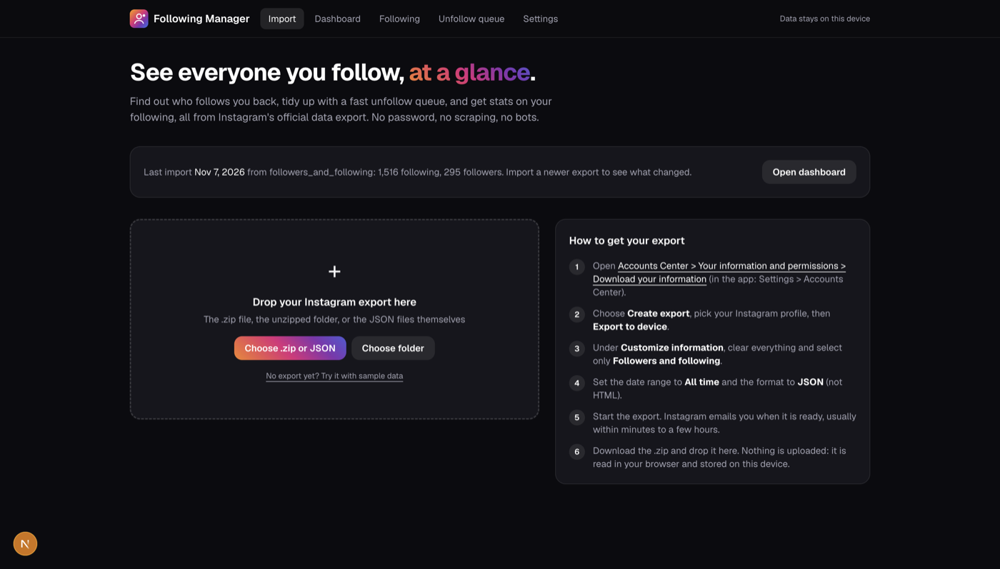
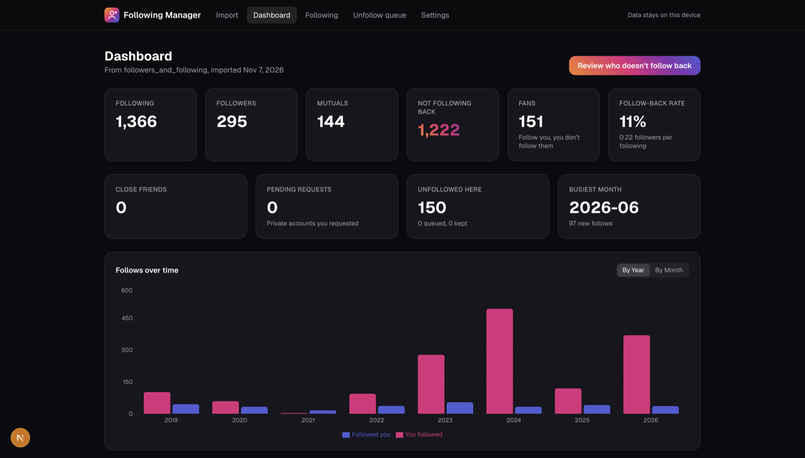

#  Instagram Following Manager

A private, local-only web app that gives you an overview of everyone you follow on Instagram: who follows you back, who doesn't, stats about your following over time, and a fast unfollow queue.

I built this as a personal tool first. My following list had grown into years of old accounts I barely remembered—people I meant to unfollow “later,” brands that no longer mattered, and profiles that made the Instagram app painful to review one by one. I wanted a clearer view of everything happening without logging into Instagram through a third party or automating anything that could get an account restricted.

| Import | Dashboard |
| :---: | :---: |
|  |  |

## How it stays within Instagram's rules

- **Official data only.** The app reads the export Instagram gives you through "Download your information". It never asks for your password, never logs in to Instagram, and never scrapes or calls private Instagram APIs, all of which Instagram's Terms of Use prohibit.
- **You do the unfollowing.** The queue opens each profile in a single reusable browser tab. You tap Unfollow on Instagram yourself and record the decision in the app. Nothing is automated.
- **Sensible pacing.** Instagram doesn't publish its limits, and many unfollows in a short time can trigger a temporary action block. The queue tracks your unfollows per day and warns you at a configurable limit (50 by default).
- **Your data stays on your device.** Everything is parsed in the browser and stored in IndexedDB. There is no backend.

## Getting your export

1. Open [Accounts Center > Your information and permissions > Download your information](https://accountscenter.instagram.com/info_and_permissions/dyi/) (in the app: Settings > Accounts Center).
2. Choose **Create export**, pick your Instagram profile, then **Export to device**.
3. Under **Customize information**, select only **Followers and following**.
4. Set the date range to **All time** and the format to **JSON**.
5. When Instagram emails you, download the .zip and drop it into the app.

The export contains usernames, profile links and follow dates. It does not include profile photos, bios or follower counts, so the app shows generated avatars instead. The export can also include deleted or suspended accounts that Instagram's live Following count hides; mark those as **Gone** in Following or the unfollow queue (`G`) so they drop out of your live stats.

## Features

- **Dashboard:** following, followers, mutuals, accounts that don't follow back, fans, follow-back rate, close friends, pending requests, busiest month, follows over time by month or year, oldest follows that never followed back, recent follows, tag breakdown, and a comparison with your previous import (new followers, people who stopped following you, and more).
- **Following explorer:** a fast list that handles thousands of accounts, with search, filters, sorting, tags, a keep list, and bulk actions.
- **Unfollow queue:** one account at a time with keyboard shortcuts: `O` or `Enter` to open the profile, `U` unfollowed, `K` keep, `S` skip, `G` gone, `Z` undo.
- **Settings:** daily limit, backup and restore of tags and decisions, managing imports, and clearing all data.

Import a fresh export every few weeks to keep the data current and see what changed.

## Development

```bash
pnpm install
pnpm dev      # http://localhost:3000
pnpm test     # parser and metrics unit tests
pnpm lint
pnpm build
```

Stack: Next.js (App Router), React 19, TypeScript, Tailwind CSS v4, Dexie (IndexedDB), fflate (unzip in the browser), zod, Recharts, TanStack Virtual, Vitest.
